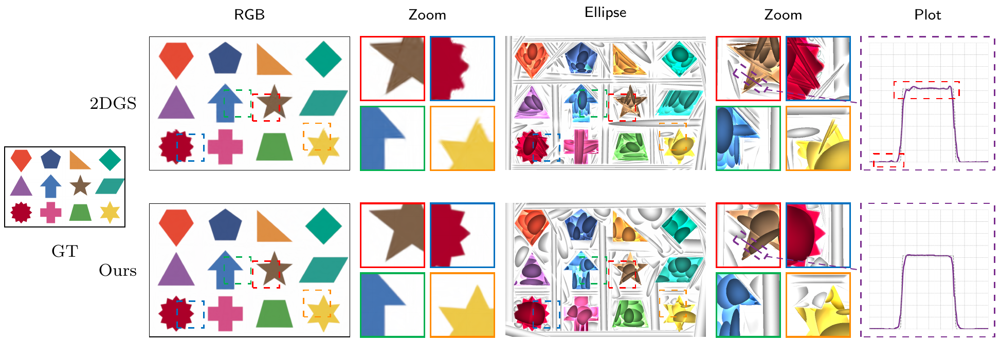
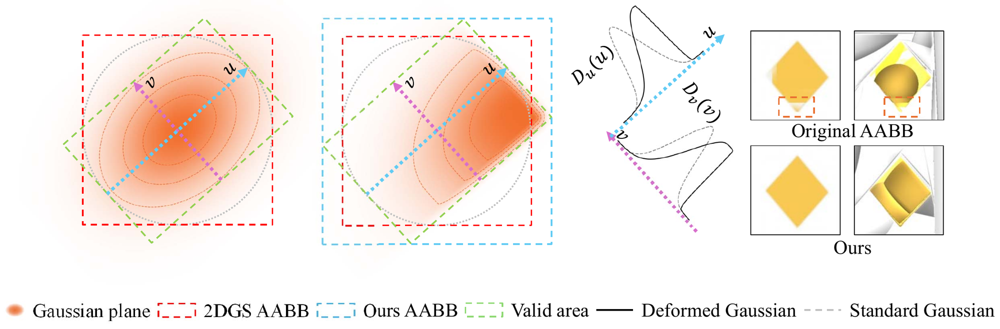
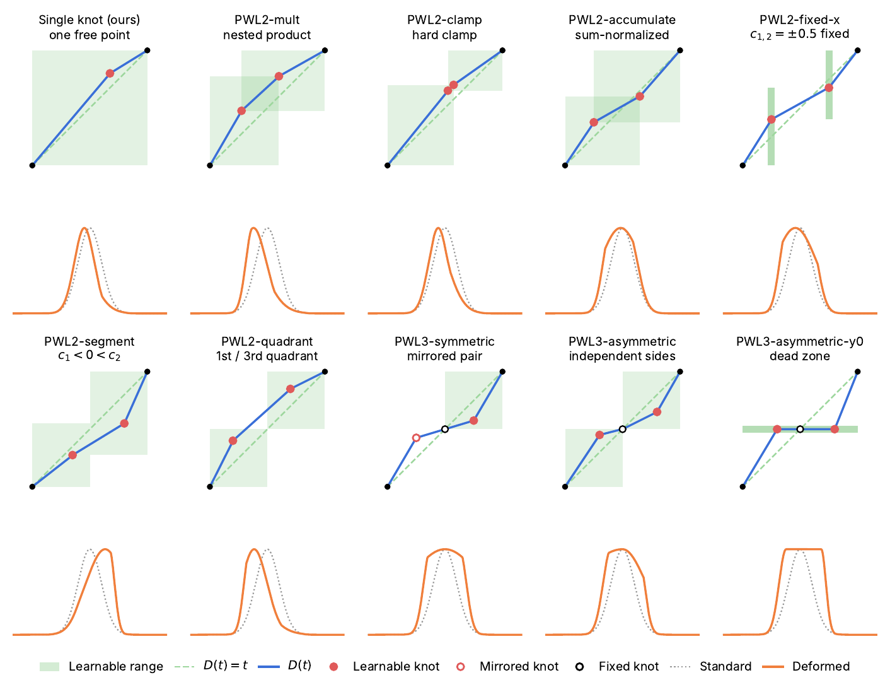

# Warp-2DGS: Learnable Warped Kernels for 2D Gaussian Splatting

Huibin Li, Chul Min Yeum<br>
CVISS Lab, University of Waterloo<br>
**NeurIPS 2026 (Spotlight)**

<!-- TODO: add [Paper](arXiv link) once it is online -->
[NeurIPS page](https://neurips.cc/virtual/2026/loc/sydney/poster/153737) | [Rasterizer](https://github.com/Matt-V50/warp-surfel-rasterization)

<p align="center">
  
</p>

2DGS (top) superimposes many Gaussians to approximate sharp boundaries and rings around them
(Gibbs). The warped kernels of Warp-2DGS (bottom) adopt a step-like edge instead; the plot on the
right shows the inverted gray value along the purple scanline.

The smooth falloff of Gaussian kernels over-smooths sharp edges, and every alternative kernel we
tested still produces Gibbs ringing at discontinuities. Instead of replacing the kernel,
Warp-2DGS makes it deformable: each 2DGS surfel passes its tangent-plane coordinates through a
learnable monotonic piecewise warp before the Gaussian is evaluated. With one free control point
per axis (four parameters per primitive), every surfel can learn an asymmetric, step-like
falloff, trained end to end with the rendering loss alone.

## Installation

```bash
git clone --recursive https://github.com/Matt-V50/Warp-2DGS.git
cd Warp-2DGS

conda env create -f environment.yml
conda activate warp2dgs

# CUDA extensions (needs a CUDA toolkit matching PyTorch, tested with CUDA 12.1)
pip install --no-build-isolation submodules/warp-surfel-rasterization submodules/simple-knn
```

The rasterizer compiles every warp kernel into its own extension, which takes about 9 minutes.
To build only some of them:

```bash
WARP_KERNELS=pwl_sr,pchip_sr pip install --no-build-isolation submodules/warp-surfel-rasterization
```

Tested on Ubuntu with an RTX 4090, Python 3.10, PyTorch 2.4.1 and CUDA 12.1.

## Training and evaluation

Data are COLMAP scenes as in [3DGS](https://github.com/graphdeco-inria/gaussian-splatting).

```bash
# train with the default PWL-sr kernel
python train.py -s <scene> -m <model> -i images_4 --eval

# render test views and extract a mesh
python render.py -m <model>

# PSNR / SSIM / LPIPS on train and test views, written to <model>/results_iter<N>.json
python evaluate_metrics.py -m <model> --iterations 7000 30000
```

The warp options are saved in `<model>/cfg_args`, so `render.py` and `evaluate_metrics.py` pick
up the kernel a model was trained with.

| Option | Default | |
|---|---|---|
| `--kernel` | `pwl_sr` | warp kernel, see below |
| `--rescale` | `3.0` | warped domain [-r, r] in units of the Gaussian scale |
| `--cutoff` | `-1` | footprint cutoff, `<= 0` means `rescale * sqrt(2)` |
| `--inter_points_lr` | `0.0025` | learning rate of the control points |
| `--image_fitting` | off | fit a single 2D image with flat, camera-facing, opaque splats |

A warped kernel can reach beyond the 3-sigma box that 2DGS uses to bound each splat on screen, so
the footprint cutoff is enlarged to `rescale * sqrt(2)` for rasterization. Densification still
uses the unwarped 3-sigma radius.

<p align="center">
  
</p>

## Kernels

| `--kernel` | Paper | |
|---|---|---|
| `pwl` | PWL | one interior knot (c1, d1) per axis |
| `pwl_sr` | PWL-sr | PWL with the slope-ratio parameterization |
| `pchip` | Pchip | piecewise cubic Hermite interpolation of the same knot |
| `pchip_sr` | Pchip-sr | Pchip with the slope-ratio parameterization |
| `identity` | 2DGS | D(t) = t, no warp |
| `pwl2_mult`, `pwl2_segment` | Appendix D | two interior knots |
| `pwl3_symmetric`, `pwl3_asymmetric`, `pwl3_asymmetric_y0` | Appendix D | knot fixed at the origin plus one on each side |
| `pwl_fixed_d`, `pchip_fixed_d` | – | d1 = 0, only c1 is learned |
| `pchip_antidiag` | – | Pchip with d1 = -c1 |
| `pwl_plateau` | – | symmetric flat top: plateau + linear ramp |
| `pchip3_symmetric` | – | Pchip counterpart of PWL3-symmetric |

Kernels marked – are additional variants not reported in the paper.

<p align="center">
  
</p>

Multi-knot deformation variants (Figure 9 of the paper). For each variant, the upper plot shows
the deformation function D(t) and the lower plot the resulting kernel G(r · D(x/r)). PWL2-clamp, PWL2-accumulate,
PWL2-fixed-x and PWL2-quadrant are not built by default; their sources are kept in
`submodules/warp-surfel-rasterization/cuda_rasterizer/experimental/`.

## Reproducing the paper

`scripts/run_experiments.py` runs every kernel x scene x resolution and skips stages whose
outputs already exist; `--dry_run` prints the commands. It expects this layout under `--data_root`:

```
Mip-NeRF360/360_v2/<scene>/images_{4,8}     # Mip-NeRF 360
tanks_and_temples/<scene>/images            # Tanks and Temples, novel view synthesis
TNT_GOF/TrainingSet/<scene>                 # Tanks and Temples, preprocessed for meshing
TanksAndTemples/trainingdata/<scene>        # official TNT ground truth (point clouds, alignments, crop files)
BlenderImage/<scene>/dataset                # single-image fitting (Figure 1)
```

- [Mip-NeRF 360](https://jonbarron.info/mipnerf360/)
- [Tanks and Temples](https://www.tanksandtemples.org/download/), including the ground truth for
  the F1 evaluation
- Preprocessed Tanks and Temples for meshing: [TnT_data](https://huggingface.co/datasets/ZehaoYu/gaussian-opacity-fields/tree/main)
  from Gaussian Opacity Fields

```bash
KERNELS="identity pwl pwl_sr pchip pchip_sr"

# Table 1 / 4: Mip-NeRF 360 (x4, x8) and Tanks and Temples novel view synthesis
python scripts/run_experiments.py --dataset mip360 --data_root <data> --output_root <out> --kernels $KERNELS
python scripts/run_experiments.py --dataset tnt    --data_root <data> --output_root <out> --kernels $KERNELS
python scripts/collect_results.py --dataset mip360 --output_root <out>
python scripts/collect_results.py --dataset tnt    --output_root <out>

# Table 2: Tanks and Temples F1 (train, TSDF mesh, official evaluation)
python scripts/run_experiments.py --dataset tnt_mesh --data_root <data> --output_root <out> --kernels $KERNELS
python scripts/collect_results.py --dataset tnt_mesh --output_root <out>

# Table 3 / 5: boundary PSNR / SSIM on the Tanks and Temples renders
python scripts/eval_boundary.py --output_root <out> [--ssim]

# Table 6: rescale factor sensitivity
python scripts/run_experiments.py --dataset mip360 --factors 8 --kernels pwl pwl_sr --rescales 2 3 4 \
    --data_root <data> --output_root <out>

# Figure 4: distribution of the learned control points
python scripts/plot_control_points.py --output_root <out> --experiments pwl pwl_sr pchip pchip_sr

# Figure 1: fit a single image, then plot a scanline of the renders against ground truth
python scripts/run_experiments.py --dataset blender_image --data_root <data> --output_root <out> \
    --kernels identity pwl_sr --save_images
python scripts/plot_line_profile.py <2dgs render> <warp2dgs render> <gt image> [--points X0 Y0 X1 Y1]
```

The official TNT evaluation needs `open3d==0.10.0`, so `tnt_mesh` runs it through a separate
conda environment (`--metrics_env`, default `2d-gs-eval`):

```bash
conda create -n 2d-gs-eval python=3.8
conda run -n 2d-gs-eval pip install -r scripts/eval_tnt/requirements.txt   # open3d==0.10
```

## Citation

```bibtex
@inproceedings{li2026warp2dgs,
  title     = {Warp-2DGS: Learnable Warped Kernels for 2D Gaussian Splatting},
  author    = {Li, Huibin and Yeum, Chul Min},
  booktitle = {Advances in Neural Information Processing Systems},
  year      = {2026}
}
```

## Acknowledgements

This code is built on [2DGS](https://github.com/hbb1/2d-gaussian-splatting) and
[3DGS](https://github.com/graphdeco-inria/gaussian-splatting). The Tanks and Temples evaluation
comes from the [official toolbox](https://github.com/isl-org/TanksAndTemples/tree/master/python_toolbox/evaluation)
and the preprocessed meshing data from [Gaussian Opacity Fields](https://github.com/autonomousvision/gaussian-opacity-fields).
Please also cite 2DGS if you use this code:

```bibtex
@inproceedings{Huang2DGS2024,
  title     = {2D Gaussian Splatting for Geometrically Accurate Radiance Fields},
  author    = {Huang, Binbin and Yu, Zehao and Chen, Anpei and Geiger, Andreas and Gao, Shenghua},
  publisher = {Association for Computing Machinery},
  booktitle = {SIGGRAPH 2024 Conference Papers},
  year      = {2024},
  doi       = {10.1145/3641519.3657428}
}
```

## License

Released under the non-commercial [Gaussian-Splatting license](LICENSE.md) of Inria and MPII,
inherited from 3DGS and 2DGS.
